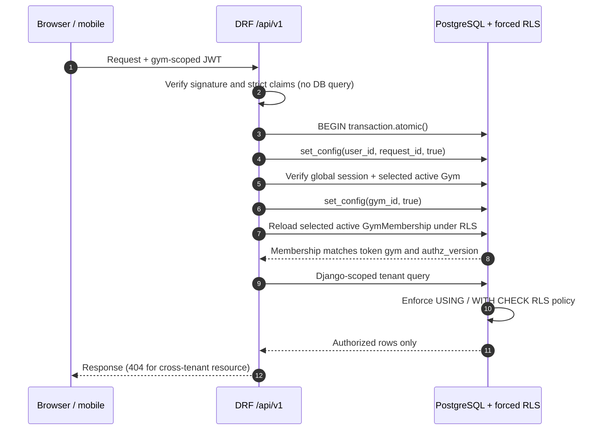
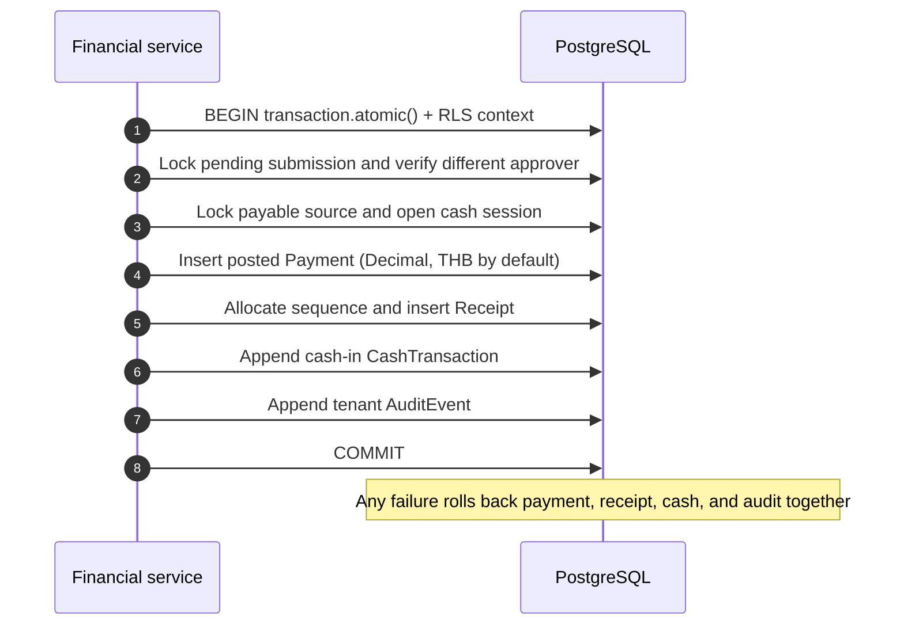
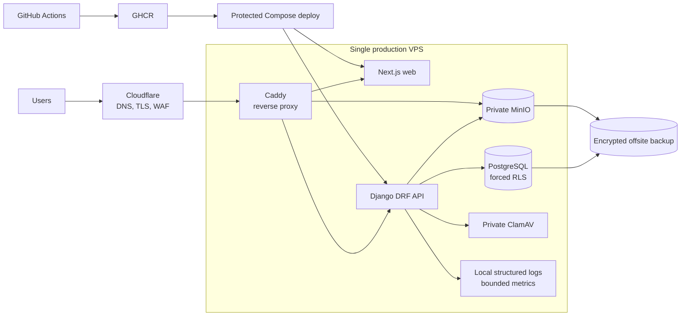

# System Architecture

> Part of the Phase 0 contract set indexed in [`README.md`](./README.md). Related: [`DATABASE.md`](./DATABASE.md), [`API.md`](./API.md), [`SECURITY.md`](./SECURITY.md), [`PROJECT_STRUCTURE.md`](./PROJECT_STRUCTURE.md), [`DEVELOPMENT_PLAN.md`](./DEVELOPMENT_PLAN.md), [`HOW_IT_WORKS.md`](./HOW_IT_WORKS.md).

## 1. Purpose and scope

This document defines the Phase 0 target architecture for a multi-tenant gym management SaaS. Phase 0 produces design documentation only; it does not implement application features, infrastructure, migrations, or policies.

The system has three deployable applications — one authoritative server and two clients:

- A Django REST Framework (DRF) API under `/api/v1` containing all authorization and business rules. This is the server, not a client.
- A Next.js 16.4.1 web application using the App Router, TypeScript 7.0.2, Tailwind CSS, and React Server Components (RSC) for platform and gym staff. It is also the browser backend-for-frontend (BFF).
- A separate React Native member application using the same versioned API.

The primary design goal is fail-closed tenant isolation. UI filtering is never a security control.

Phase 1A is foundation only. It creates authentication, tenancy, authorization, RLS, API infrastructure, and minimal web shells; it does not implement members, check-in, finance, PT, reports, or mobile features. Phase 1B platform administration, provisioning, staff, roles, settings, audit reads, and file-metadata persistence are in place and gate-closed. Phase 2 publishes the MembershipPlan and Member list, create, detail, update, and archive APIs, the Membership sale, lifecycle, and expiry API, the member summary API, and the nested member payment-history read. That history orders `received_at DESC, id DESC` through `payment_gym_member_hist_idx` and stops at the page limit. Membership-expiry scheduling and delivery commands are implemented. The member and membership browser workspaces follow those cursor pages, and the membership workspace can browse one expiry bucket at a time. The private profile-photo routes are implemented. Manual check-in, check-out, nested member check-in history, and staff QR challenge issuance are published. Member login, refresh, and logout are published for one already linked member. Member-self QR redemption is published at `POST /api/v1/member/check-ins/scan/`. The generic staff scan path, notification HTTP routes, and general payment and receipt endpoints remain unpublished. Trainer scan remains a Phase 5 assignment-scoped extension and is not implemented. Display-device management, device challenge issuance, and NFC or biometric ingestion are published. No vendor-specific adapter is implemented, and no biometric template, raw capture, or vendor secret is stored. Vendor-specific integration remains optional. Public member identity linking, multi-member selection, the React Native app, and broader Phase 7 mobile APIs remain deferred and are not prerequisites for the already-linked member QR path. Phase 2 implementation is complete. Phase 3 implementation is complete as of 2026-10-18 under ADRs 0004–0008. Closure evidence is in the repository README: 225 non-PostgreSQL unit tests, 171 full PostgreSQL tests plus one focused check-in plan test, the earlier web build and 263 component and unit tests, and 4 passing Playwright specs. The query-plan baseline is not a production load test. `is_pt_client` stays false until Phase 5. Production expiry delivery remains gated on an idempotency-capable transactional provider. Production object-storage image approval also remains open: local and end-to-end Compose use digest-pinned `docker.io/pgsty/silo`, a third-party MinIO-compatible fork, not official MinIO.

## 2. Architecture principles

1. Every tenant-owned record belongs to exactly one `Gym`.
2. The authenticated server context, never client input, selects the active gym.
3. Tenant isolation is enforced independently by API scoping and PostgreSQL row-level security (RLS).
4. Business rules live in backend domain services, not views or clients.
5. Financial values use decimal arithmetic and posted financial events are reversed or voided, not deleted.
6. PostgreSQL is the source of truth. Redis and Celery are introduced only for measured needs.
7. Public API contracts are versioned and do not expose Django models directly.
8. Server timestamps are UTC; business dates are interpreted in each gym's IANA timezone.
9. Currency defaults to Thai baht (`THB`), while source documents retain an explicit ISO 4217 currency.
10. Authentication, tenant selection, authorization, and financial writes fail closed when required context is missing or inconsistent.

## 3. Logical system view

```text
Web browser                   React Native member app
     |                                  |
     | HTTPS                            | HTTPS
     v                                  v
Cloudflare
     |
     v
Single production VPS
     |
     +-- Caddy reverse proxy (80/443 only)
     |
     +-- Docker private network
           |-- Next.js web
           |-- Django REST Framework API
           |-- PostgreSQL + forced RLS
           |-- MinIO private object storage
           +-- bounded monitoring/logging
     |
     +-- encrypted offsite database/WAL/object backups

GitHub Actions --> GHCR --> protected Docker Compose deployment
```

Next.js is the browser backend-for-frontend (BFF) for authentication cookies and server rendering. Browser JavaScript never receives an access JWT or refresh token. Django `/api/v1/auth/` accepts only the trusted BFF shared secret and, in production settings, refuses a non-loopback listen host. That is application fail-closed behavior, not a network proof: production infrastructure must keep Django unpublished (private Docker network, no host port) so the internet path is `Browser → Next.js BFF → private Django → PostgreSQL`. The shared secret must never replace that isolation. Django remains the identity, token, session, tenant-selection, authorization, and revocation authority; the BFF only mediates browser requests and must not duplicate those rules or any financial rule. React Native calls the same API contracts directly. The single VPS is an explicitly accepted budget-production single point of failure; it is not represented as high availability.

## 4. Application boundaries

### Web frontend

- Next.js 16.4.1 with TypeScript 7.0.2, Tailwind CSS, the App Router, and React Server Components by default.
- Client Components only for browser-only interaction or local transient state.
- Feature modules consume typed API contracts.
- Route layouts separate `(auth)`, tenant routes, and `super-admin`.
- Permission-aware navigation improves usability but does not grant access.
- No direct database or object-storage access.

### Backend API

- Django REST Framework provides `/api/v1/`.
- Authentication establishes user, session, and active gym.
- Tenant-aware querysets and serializer relation fields constrain all data access.
- Permission classes evaluate stable permission codes.
- Domain services own membership expiry, finance approval, payments, salary, commission, cash reconciliation, receipt sequencing, and reporting rules.
- Selectors encapsulate complex read queries and tenant-scoped aggregates.
- Database transactions define business operation boundaries.

### Mobile application

- React Native with TypeScript in a separate `/mobile` workspace.
- Access tokens are short-lived; refresh credentials use Keychain/Keystore-backed storage.
- API, authentication, feature, navigation, and UI layers are separated.
- Offline caching is limited to non-sensitive display data with explicit invalidation.
- QR payloads use opaque, short-lived, rotatable identifiers rather than member or gym secrets. The mobile client supports both staff-scanned member QR and authenticated member/trainer scanning of an onsite rotating gym check-in challenge.

## 5. Multi-tenant architecture

The platform uses one PostgreSQL database and shared tables. `Gym` is the tenant root. Every tenant-owned table has `gym_id UUID NOT NULL`, including members, plans, memberships, check-ins, onsite QR challenges, payments, expenses, salary periods/lines, trainers, PT/class schedules and session balances, products, stock movements, retail sales, commissions, cash records, receipts, announcements, device registrations, files, notifications, staff assignments, and tenant audit events.

Tenant context is established as follows:

1. Verify JWT signature, issuer, audience, algorithm, token type, and expiry.
2. Read `sub`, `gym_id`, `gym_membership_id`, `session_id`, and `authz_version`.
3. Begin the request database transaction and set transaction-local `app.user_id` and `app.request_id`.
4. Validate the global refresh/session record, selected gym claim, active user, active gym, and subscription without querying tenant-owned tables.
5. Set transaction-local `app.gym_id` from that validated server-side selection.
6. Reload the selected `GymMembership` under forced RLS and verify active status, user/gym agreement, and current authorization version.
7. Execute only Django-scoped tenant queries and permission checks.

The client may send resource identifiers, but it cannot select ownership. Create services assign `gym=request.gym`; serializer fields never accept writable `gym_id`.

Cross-tenant identifiers return `404` for ordinary resource APIs to avoid disclosing existence.

## 6. PostgreSQL RLS integration

RLS is enabled and forced on every tenant-owned table. Policies use both `USING` and `WITH CHECK`.

```sql
ALTER TABLE members_member ENABLE ROW LEVEL SECURITY;
ALTER TABLE members_member FORCE ROW LEVEL SECURITY;

CREATE POLICY member_gym_isolation ON members_member
USING (
  gym_id = NULLIF(current_setting('app.gym_id', true), '')::uuid
)
WITH CHECK (
  gym_id = NULLIF(current_setting('app.gym_id', true), '')::uuid
);
```

The API runs as a non-owner, non-superuser role without `BYPASSRLS`. A separate migration role owns schema objects. Platform-wide operations use narrowly scoped service functions or an explicitly audited operational path; the normal tenant runtime never gains a general RLS bypass.

All tenant database work is wrapped in `transaction.atomic()`, including API requests, workers, scheduled jobs, management commands, and tenant-aware operational tools. Staff authentication installs context in two transaction-local steps: first the globally authenticated identity and request, then the gym only after global session and selected-gym validation. The first tenant query occurs after all three values are installed:

```python
SELECT set_config('app.user_id', %s, true),
       set_config('app.request_id', %s, true);

-- After global session, selected gym, user, and gym lifecycle checks:
SELECT set_config('app.gym_id', %s, true);
```

The `true` argument prevents tenant context leaking through persistent or pooled connections after commit or rollback. Tenant queries must not run in middleware before the transaction context exists. Workers and management commands establish the same context for one gym per transaction.

## 7. Identity and authorization

### Data ownership classification

The shared PostgreSQL schema separates platform-global data from tenant-owned data:

- **Platform-global:** `User`, authentication credentials, pre-session `GymSelectionTicket` records, refresh-session/token-family records, platform roles, platform audit events, system permission definitions, deployment metadata, and other records whose meaning is independent of a gym. These records do not acquire a nullable `gym_id` merely for convenience.
- **Tenant root:** `Gym` identifies a tenant. Its lifecycle is managed through a tightly controlled platform path.
- **Tenant-owned:** `GymMembership`, gym settings, staff profiles and assignments, members, plans, member memberships, check-ins and onsite QR challenges, payments, refunds, expenses, salary periods/lines, trainer/PT/class schedules and session ledgers, products and stock movements, retail sales and lines, commissions, cash sessions and transactions, receipts, announcements, device registrations, tenant files, notifications, and tenant audit events. Every such table has a physical `gym_id UUID NOT NULL`, including join, history, and derived tables. A transactional outbox remains deferred; if introduced after measured need, it will also be gym-owned and RLS-protected.

Tenant ownership is explicit rather than inferred through a join. Foreign keys and uniqueness constraints include `gym_id` where necessary to prevent same-tenant relationships from crossing gyms. Platform-global operations are separated from tenant request paths and never turn a tenant table into globally readable data.

`User` is a global authentication identity and can have multiple `GymMembership` records, including multiple simultaneously active memberships for legitimate engagements at different gyms. Each `GymMembership` belongs to exactly one gym. Every gym-scoped access token selects exactly one currently active membership and carries both its `gym_membership_id` and `gym_id`; it never grants an implicit union of all of the user's memberships. A `StaffProfile` remains gym-specific.

A gym may have multiple active Owner memberships. Each Owner authenticates with an independent user/session and receives the same protected OWNER role within that gym; no shared account or password is used. Owner addition and revocation use a separate audited, MFA-protected workflow, lock the gym row, and preserve at least one active Owner. `is_owner` is an authorization marker only. Ownership percentages, capital contributions, and profit distributions are outside the current model and can later be added as separate effective-dated domain records without changing login, tenant isolation, or historical finance semantics.

Authorization combines:

1. active user and non-revoked session;
2. active gym and subscription;
3. active `GymMembership`;
4. one or more roles;
5. role permission codes;
6. object conditions, such as a trainer being assigned to a member;
7. feature entitlement where applicable.

Roles are data-driven. System role templates seed OWNER, MANAGER, RECEPTIONIST, ACCOUNTANT, and TRAINER. Gym owners may create custom roles without creating new application code. Permission codes remain stable API capabilities.

Platform `SUPER_ADMIN` is a platform role, not a tenant role. Its routes, permissions, UI, and audit trail are separate.

## 8. Authentication flow

JWT acceptance is strict: use an algorithm allowlist; verify signature, issuer (`iss`), audience (`aud`), expiry (`exp`), not-before (`nbf`) when present, issued-at sanity, token type, subject, session, and required tenant claims. Reject `alg=none`, algorithm/key confusion, unknown key IDs, malformed or duplicated claims, revoked sessions, inactive users, inactive memberships, gym/membership mismatches, and stale authorization versions. Clock skew is small and explicit. The API never accepts `gym_id` from a header, URL, cookie, or request body as a substitute for the verified token selection.

Authentication middleware performs cryptographic and syntactic token validation only and makes no tenant database queries. A transaction-wrapped API boundary first sets `app.user_id` and `app.request_id`, validates global session and selected-gym state, then sets `app.gym_id`. Only then does it reload `GymMembership` and perform tenant authorization under forced RLS and Django scoping.



### Staff web

1. Browser JavaScript submits credentials to a same-origin Next.js BFF route over HTTPS. The BFF forwards the command to Django and never returns token values in JSON, HTML, logs, URLs, or client-visible state.
2. Django validates password and required MFA, then derives the authoritative active `GymMembership` bootstrap list. One active membership proceeds directly to normal selected-gym access and rotating-refresh issuance. Zero fails closed.
3. Multiple active memberships cause Django to create a high-entropy, opaque, single-use `GymSelectionTicket` that expires in exactly 5 minutes. Only its cryptographic hash, user binding, immutable eligible-membership snapshot, expiry, consumed/revoked state, bounded attempts, and safe metadata are stored. No JWT, refresh session, gym authority, or tenant context exists yet.
4. The trusted BFF receives the plaintext ticket once and stores it only in a dedicated `HttpOnly`, host-scoped, `SameSite=Lax` cookie with no `Domain` attribute and `Secure` outside isolated localhost. Browser JavaScript sees only safe membership display choices and submits only the chosen `gym_membership_id`.
5. The BFF supplies that ID and ticket to Django. Django atomically locks the ticket; verifies hash, user, expiry, state, and attempt bound; verifies the chosen currently active membership against the ticket's authoritative bootstrap list; consumes the ticket; and only then issues the normal selected-gym access/rotating-refresh session. Terminal failure revokes the ticket; replay cannot create a second session. The BFF clears the ticket cookie on success or terminal failure.
6. The BFF stores normal credentials only in `HttpOnly`, host-scoped cookies with `SameSite=Lax` and no `Domain` attribute. Cookies are `Secure` outside isolated `http://localhost` development. Authentication credentials and tickets are never written to `localStorage` or `sessionStorage`.
7. The staff access-token target lifetime is 10 minutes. On an authenticated browser request, the BFF reads the cookies server-side and forwards the access JWT to Django. Browser JavaScript sees only application responses.
8. Every BFF route that can create, rotate, select, revoke, or otherwise mutate cookie-authenticated or ticket state requires a valid CSRF token/header and strict allowlisted `Origin` validation, with strict `Referer` validation only where `Origin` is unavailable. Missing or mismatched provenance fails closed.
9. If Django returns the single eligible access-expiry response, the BFF performs at most one controlled refresh and retries the original request once. Django rotates the refresh credential atomically; reuse revokes the entire refresh family. Other authentication or authorization failures are not refresh loops.
10. Logout and logout-all call Django's authoritative revocation endpoint before completing. The BFF clears all authentication cookies with matching host/path attributes even when revocation reports an already-expired session; it never treats cookie deletion alone as revocation.

```mermaid
sequenceDiagram
    autonumber
    participant B as Browser JavaScript
    participant N as Trusted Next.js BFF
    participant A as Django authentication
    participant D as PostgreSQL control plane
    B->>N: Login credentials + CSRF/provenance
    N->>A: Forward password/MFA command
    A->>D: Verify user; derive active membership bootstrap list
    alt One active membership
        A->>D: Create selected RefreshSession
        A-->>N: Access + rotating refresh credentials
        N-->>B: Safe authenticated state only
    else Multiple active memberships
        A->>D: Store ticket hash + user + list + 5-minute expiry
        A-->>N: Plaintext ticket + safe choices
        N-->>B: Safe choices only; ticket stays HttpOnly
        B->>N: Chosen gym_membership_id
        N->>A: Choice + ticket
        A->>D: Lock, verify, consume ticket; revalidate membership
        A->>D: Create selected RefreshSession
        A-->>N: Access + rotating refresh credentials
        N-->>B: Safe authenticated state only
    end
    Note over B,D: No gym authority or tenant context before successful selection
```

Staff JWT identifiers are stable configurable non-secret values: issuer `gym-platform-api` and staff/web audience `gym-platform`. Member access uses audience `gym-platform-member`. Signing material remains secret, but these identifiers do not.

### Mobile member

Member authentication maps a global user identity to a gym-scoped `Member` record. The token includes that gym and member link. Member endpoints enforce both tenant scope and self scope.

### Authorization changes

Role changes, suspension, password reset, and session revocation increment `authz_version` or revoke sessions. Sensitive requests compare token state with authoritative storage.

## 9. Data and domain architecture

Apps are organized by domain: tenants, users, members, memberships, check-ins, payments, expenses, salaries, trainers, classes, inventory, sales, commissions, cashbook, receipts, reports, announcements, notifications, files, and audit.

Views coordinate HTTP concerns. Serializers validate API input/output. Services perform commands and transactions. Selectors build optimized reads. Models enforce local invariants, while database constraints enforce durable integrity.

Cross-domain financial writes are atomic and occur only after the pre-post approval gate. For example, approving a submitted membership cash payment may post the payment, create its receipt and cash transaction, settle the membership, and append an audit event in one transaction. External work is emitted through a transactional outbox only when background delivery becomes necessary.

The member PT badge is a selector result, not client-owned member state: `is_pt_client` is derived from a same-gym `TrainerAssignment` with `status = ACTIVE` whose effective range contains the requested gym-local date. Ending or cancelling the assignment removes the badge without rewriting the member.

PT and class remaining sessions are derived from an immutable tenant-owned session ledger, not a client-maintained counter. A package purchase grants sessions; completed attendance and policy-approved no-shows consume them; authorized corrections append reversing ledger entries. Booking services lock the relevant trainer, member, class occurrence, capacity, and balance rows so concurrent requests cannot oversell capacity, double-book time, or consume one remaining session twice.

Inventory uses an append-only stock-movement ledger. Approved retail sale posting atomically creates immutable sale lines with unit-price and unit-cost snapshots, posts the payment/receipt/cash effects, and deducts stock under product-row locks. Quantity on hand and gross profit are server-derived; clients cannot set stock balances, cost of goods sold, or profit totals.

Unattended mobile check-in uses an authenticated member or, later, an authorized trainer principal plus a short-lived, replay-bounded onsite challenge for exactly one gym. The challenge is not authority by itself. Member-self redemption locks the challenge, then the token member, then the eligible membership, and writes one `QR` check-in with no gym-membership actor. It does not lock gym settings. A display device authenticates with its own credential and issues a challenge for itself. That path locks gym settings, then the device row only, then that device's active challenges. It does not lock `tenants_gym`. Trainer scan is a Phase 5 assignment extension and does not add a second scan route. An NFC or biometric credential can record one server-timed visit for a same-gym member and cannot issue a challenge. A display credential cannot ingest. A static reusable poster QR is not sufficient for unattended admission.

Membership-expiry email is implemented as two bounded Django management commands, `schedule_membership_expiry_emails` and `deliver_membership_expiry_emails`. The scheduler creates due `Notification` rows from each active gym's local date and configured warning days. The delivery command processes active gyms under an explicit transaction-local tenant context and sends through Django's configured email backend with `fail_silently=False`. It does not select a vendor. Each due row is locked with `select_for_update(skip_locked=True)` and committed in its own transaction, so concurrent command runs and ordinary reruns do not deliver one row twice. A row is created only when the gym is active, the memberships entitlement and expiry-email setting are enabled, the member and membership are active, the warning day matches the gym-local date, and `Member.email` is a current nonblank normalized address. Missing email is a normal skip with no row and no SMS or phone fallback. Delivery resolves that current address again, cancels without a provider call when the address was removed or the membership is no longer eligible, and retries provider failures with a five-attempt exponential backoff. A lower `--max-attempts` marks a due pending row failed once its stored count has already reached that ceiling, without another provider call or attempt increment. Stored errors are only the stable codes `PROVIDER_UNAVAILABLE` and `DELIVERY_REJECTED`. The uniqueness key is `(membership_id, expiry_date, warning_day, template_version)`. The plain-text message sets `X-Idempotency-Key` to that key. Database locks deduplicate command concurrency and reruns. The remaining crash window — the provider accepts the message and the process dies before the status commit — stays open until a production backend honors that header. Production readiness is blocked on that approved transactional provider. Vendor selection remains a deployment decision. Notification HTTP routes stay unpublished. This queue does not use Celery; Celery remains deferred until measured workload justifies it.

Member push reminders and gym event/promotion announcements reuse the tenant-owned notification boundary. Announcement audience selection resolves to explicit same-gym recipients; device push tokens are scoped to a member, gym, device, and revocable session. Delivery failure never changes authoritative membership, booking, or payment state.

All persisted timestamps are UTC. Gym-local business dates, reporting cutoffs, receipt dates, and cash-day boundaries are derived using the gym's validated IANA timezone. Legacy `Asia/Rangoon` input is normalized to canonical `Asia/Yangon` before storage and comparison; both names must produce identical historical offset behavior. Clients may format local time but do not define business-day boundaries.

## 10. Financial architecture

- Monetary model fields use Django `DecimalField(max_digits=18, decimal_places=2)`, PostgreSQL `NUMERIC(18,2)`, and Python `Decimal` end to end. Binary floating point is prohibited for money.
- Each financial row stores a three-letter currency copied from the gym or source document. New gyms default to `THB`.
- A transaction cannot mix currencies.
- Drafts may be edited; submission freezes their business fields. Submitted payments, expenses, retail sales, PT sales, and salary periods require approval by a different authorized Manager or Owner before posting. Posted payments, retail sale lines and stock movements, expenses, salary records, commissions, receipts, cash transactions, and cash closes are immutable. Even privileged users cannot update or delete posted economic facts.
- Corrections use `VOID`, `CANCEL`, `REFUND`, or reversing records linked to the original.
- Derived totals are calculated in backend services or database aggregates, never trusted from clients.
- Idempotency keys protect retryable financial commands.
- Every financial command verifies tenant scope, permission, amount sign and scale, currency, business date, source status, and idempotency key inside one `transaction.atomic()` boundary.
- Approval also verifies that the approver is not the creator or submitter. Rejection records actor, time, and reason but creates no financial side effects.
- Receipt numbers and other tenant sequences are allocated atomically per gym; gaps are retained and explained rather than silently reused.

### Atomic financial workflows

- **Finance submission:** an authorized creator with the module's create permission creates an editable draft and submits it. Submission freezes business fields and creates no receipt, settlement, commission, expense, or cash movement.
- **Cash payment approval:** a different authorized Manager or Owner locks the submitted payment, payable source, and relevant cash session; posts the immutable payment, allocates and creates its receipt, appends the cash-in transaction, updates source settlement state, and appends a tenant audit event. Commit all records together or none.
- **Non-cash payment approval:** posts the same payment, receipt, settlement update, and audit evidence but no cashbook entry unless cash physically moves.
- **Void/refund:** never overwrite the original. Validate refundable balance, create a linked void or refund/reversal record and corrective receipt document, append the opposite cash transaction when money leaves or enters a till, update derived settlement status, and audit the reason and actor atomically.
- **Expense:** an authorized creator submits a draft; approval by a different Manager or Owner posts the immutable expense, its evidence/reference, a cash-out transaction when paid from a till, and an audit event in one transaction. Rejection remains visible and has no cash effect; post-approval correction uses reversal.
- **Salary:** Reception or finance staff enters per-period salary lines; no fixed amount is inferred from a staff profile. Submission freezes the period. Approval by a different Manager or Owner atomically posts one protected `STAFF_SALARY` expense per line and any cash-out movements. PT commission remains a separate domain and category.
- **Cash close:** lock the cash session, calculate expected cash from its immutable opening amount and posted movements, record counted cash and variance, close the session once, and append audit evidence atomically. Reopening is not an edit; it requires an explicitly authorized correcting workflow.
- **Payments increment 3:** the same command boundary posts a pending payment. `mutate()` reloads the actor and live `payments.approve` permission, requires an active protected Manager or Owner who is not the creator or submitter and does not hold the protected Reception role, locks the payment, then the membership, then the cash session inside `record_cash_movement`, then allocates `RECEIPT:<year>`, marks the payment posted, and inserts the issued receipt. Receipt HTML is rendered on download and is not stored. Direct SQL cannot commit a posted payment without that receipt, or a cash payment without one matching movement, unless the migration marked `legacy_unlinked_cash`. Void, refund, and receipt replacement stay unpublished. Runtime inserts must start as drafts. Until the reversal increment, only the migration role or a superuser may move a posted payment to void and store the reciprocal reversal link. `gym_runtime` cannot void a posted payment, and a session setting does not authorize that transition. The staff UI is deferred to increment 9.
- **Cash book increment 2:** command views use `non_atomic_requests`. Authentication, entitlement, permission, throttling, and serializer validation commit in a short transaction before `run_idempotent()`. The runner then owns the claim transaction and the business transaction. `mutate()` reloads the active membership, user, gym, finance entitlement, and live permission, locks the `CashSession` before related `CashTransaction` rows, repeats Reception own-session scope and the interim Owner-only adjustment check, returns only HTTP 200–299, and writes the audit event in that same business transaction. A movement helper locks the session itself and must run inside an open transaction. Register codes are uppercase tokens with no register catalog. Movements are append-only. A deferred constraint keeps stored totals equal to those movements at commit. Reception object scope is `opened_by_membership_id` and is not removed by another role. The staff UI is deferred to increment 9.
- **PT sale and commission:** an authorized creator submits the PT-sale draft and optional payment; approval by a different Manager or Owner atomically posts the sale/payment/receipt/cash effects and derives one commission using the captured percentage. Commission payout later creates a protected `PT_COMMISSION` expense, a cash-out transaction when applicable, and an audit event; reversal preserves the original accrual and payout.



An accounting ledger can be added later without changing public payment and expense contracts; source records retain stable identifiers, explicit event history, and enough immutable linkage to support that evolution.

## 11. File architecture

MinIO exposes one private S3-compatible bucket on the VPS internal Docker network. It publishes no host port and allows no anonymous bucket or object access. Caddy reverse-proxies a separate public object origin to that private endpoint and preserves the public `Host`. The browser uses that origin only for a presigned POST or GET. PostgreSQL stores tenant-scoped metadata, the member owner, the object key, the original upload declaration, the authoritative sanitized content type, size, and checksum, scan status, the scan-attempt token, and retention status.

The Phase 2 flow is a member profile photo, purpose `PROFILE_PHOTO`, and it is implemented. The HTTP fields, statuses, and retry rules are in `API.md`. Production MinIO-compatible credentials and ClamAV deployment remain gated. The local image is the digest-pinned third-party fork `docker.io/pgsty/silo`, not official MinIO, and production image approval remains unresolved. The sequence is:

1. authorize an upload intent for the token gym and an existing same-gym member;
2. insert `PENDING` / `QUARANTINED` metadata and return a 300-second presigned POST whose policy binds the exact key, exact content type, the exact signature algorithm, credential, and date, and maximum 5,242,880-byte size;
3. the browser posts the original bytes directly to the public object origin;
4. complete locks the member and asset, claims `SCANNING` with a new `scan_attempt_id`, commits, and releases those locks;
5. with no database transaction or row lock held, complete reads the object, checks the original SHA-256 and byte size, scans it with ClamAV, decodes it within 20,000,000 pixels, re-encodes it without metadata, overwrites the same key, and scans the canonical bytes;
6. a second short transaction stores the sanitized checksum, size, and content type and marks `CLEAN` / `ACTIVE` only when that attempt token still matches and retention is still `QUARANTINED`;
7. a later member update attaches that asset. Complete does not attach it.

A download is a separate authorized 60-second presigned GET. Its integrity check is a `HEAD` of server-written object metadata and `Content-Length`, specified in `API.md`. The signed response disposition is `inline; filename="profile-photo.jpg"` (or `.png` / `.webp`), with the sanitized content type and `private, no-store`, because the staff UI renders that sanitized image. It is not a general document mode. Delete updates retention, clears any scan attempt, and removes the object without deleting the database row. `expire_profile_photo_uploads` also retires `CLEAN` and `ACTIVE` profile photos that are at least 24 hours old and not referenced by any same-gym member, using the claim and retry rules in `API.md`. Upload intent, complete, download-url, and delete disable the request-scoped atomic wrapper. Each of their database steps is its own committed transaction, and no step holds a database transaction or row lock across MinIO, ClamAV, or image processing. A `SCANNING` claim at least 120 seconds old may be replaced. Object paths are not authorization controls. ClamAV is a private container on the same Docker network, with no published port. Production endpoints and credentials are environment-provided, as listed in `SECURITY.md`.

```mermaid
sequenceDiagram
    autonumber
    participant C as Staff browser
    participant B as Next.js BFF
    participant A as DRF API
    participant S as Private ClamAV
    participant O as Private MinIO via Caddy
    participant D as PostgreSQL
    C->>B: POST upload intent
    B->>A: Forward staff JWT and body
    A->>D: Insert PENDING and QUARANTINED asset
    A-->>B: Presigned POST url, form fields, 300-second expiry
    B-->>C: Same JSON
    C->>O: Multipart POST original bytes
    O-->>C: 204
    C->>B: POST complete with original sha256 and byte size
    B->>A: Forward complete
    A->>D: Lock member, then asset; claim SCANNING and commit
    A->>O: Read object and verify original checksum and size
    A->>S: Scan original bytes
    A->>A: Decode, enforce pixel limit, re-encode without metadata
    A->>O: Overwrite key with canonical bytes and server metadata
    A->>S: Scan canonical bytes
    A->>D: Finalize CLEAN and ACTIVE only if the attempt token still matches
    A-->>B: Sanitized metadata, attachable true
    B-->>C: Same JSON
    C->>B: PATCH member profile_photo_asset_id
    Note over C,O: A later download is a new 60-second presigned GET
```

## 12. Deployment architecture

The approved compatibility baseline is Python 3.14.7, Django 5.2.17 LTS, Django REST Framework 3.18.0, Node.js 24.20.0 LTS, Next.js 16.4.1 Active LTS, PostgreSQL 18.6, and TypeScript 7.0.2. Next.js 16.4.1 is an approved security compatibility update. `docs/DEVELOPMENT_PLAN.md` remains the immutable historical baseline and still records Next.js 16.3.3. Phase 1A pins these exact versions in runtime, lock, container, and CI configuration. The selected Django LTS and DRF releases support the Python baseline; Next.js and TypeScript run on the selected Node LTS; PostgreSQL compatibility is exercised through the actual driver, migrations, constraints, transaction-local settings, and forced-RLS test suite rather than inferred from version labels.

- Cloudflare provides DNS, edge TLS, WAF, bot/rate controls, and origin protection; the free tier is the budget baseline.
- One production VPS provides 4–8 vCPU, 8–16 GiB RAM, and 80–160 GiB NVMe storage, subject to measured load. It runs a pinned Linux release, host firewall, automatic security patches, and Docker Compose.
- Caddy is the only public origin service and exposes ports 80/443. SSH is key-only and restricted by firewall/admin source. PostgreSQL, MinIO, and ClamAV publish no public host ports. Caddy proxies the public object origin to private MinIO for presigned POST and GET only.
- Local Docker Compose runs private S3-compatible storage, ClamAV, and a Caddy object-origin proxy with development placeholders only. The storage image is digest-pinned `docker.io/pgsty/silo`, a third-party MinIO-compatible fork. It is not an official MinIO image. Official MinIO images are not anonymously distributable, so production object-storage image and provider approval remains an unresolved deployment gate. Production ClamAV deployment and storage credentials are not committed. Containers communicate only over explicit private networks and use persistent named volumes.
- Docker secrets or root-readable encrypted environment files provide database credentials, JWT signing material, storage credentials, and provider secrets. Plaintext secrets never enter Git or image layers.
- GitHub Actions runs tests/scans and publishes immutable images to GitHub Container Registry (GHCR). A protected deployment pulls digest-pinned images, runs a one-shot migration service with the migration role, performs health checks, and switches/restarts services in a controlled order.
- Encrypted PostgreSQL base/logical backups, WAL archives, and MinIO object backups leave the VPS for an independent S3-compatible backup provider. A backup stored only on the VPS is not a backup.
- Production and staging never share database volumes or credentials. Routine staging runs locally or on an ephemeral temporary VPS; the production VPS does not host a permanently running staging stack within the approximately $80 monthly budget.



VPS database capacity must satisfy:

```text
web/API worker processes × maximum database connections per worker
+ migration/operations reserve
< PostgreSQL max_connections
```

The initial worker count, connection lifetime/pool behavior, memory limits, and PostgreSQL buffers are fixed from load-test evidence. Docker memory/CPU limits reserve capacity for PostgreSQL and backup/restore operations; containers must not compete until the host swaps or exhausts disk.

## 13. Reliability, backup, and recovery

- The single VPS has no automatic failover. Host, disk, datacenter, or network failure may cause downtime until the VPS is repaired or rebuilt.
- PostgreSQL takes a daily encrypted base/logical backup and continuously archives WAL offsite. MinIO objects are versioned where practical and synchronised to independent encrypted offsite storage.
- Backup credentials are write-limited where supported and are not the same credentials used by the production application. Retention and deletion protection are approved before launch.
- Infrastructure configuration, Compose files, migration files, and restore scripts are stored in version control; secrets and backup encryption keys are stored separately.
- External monitoring alerts on HTTPS availability, certificate expiry, disk/RAM pressure, PostgreSQL health, backup age, WAL archive failure, object-sync failure, and failed deployment.
- Quarterly restore drills rebuild an isolated temporary Compose stack or replacement VPS from immutable images and offsite backups.
- The planning targets remain RPO ≤ 15 minutes through WAL archiving and RTO ≤ 4 hours through a rehearsed rebuild/restore runbook. They are targets, not an HA guarantee, and must be proven by drills before production.
- Restore procedures verify tenant isolation policies, database roles, forced RLS, financial constraints, audit evidence, and object references before recovered service is exposed.

## 14. Observability

Every request carries a validated or generated request ID, which is also installed as transaction-local `app.request_id`. Structured container logs include safe identifiers, gym ID only where authority has been established, route, status, latency, and actor ID, but no tokens, ticket plaintext, or sensitive payloads. Gym-selection issue/use/replay/expiry/revocation and throttling are audited by internal ticket ID or non-reversible fingerprint. Logs use bounded rotation and selected security/availability events are sent off-host. Lightweight metrics and external checks cover API errors, latency, authentication failures, gym-selection failures/rate limits, RLS/scoping denials, database connections and saturation, VPS disk/RAM/CPU, transaction failures, backup freshness, restore-test results, presigned URL failures, and suspicious authorization denials.

Audit logs are domain evidence, distinct from diagnostic application logs.

## 15. Scalability path

1. Optimize indexes, query plans, pagination, worker counts, container limits, disk use, and database connections on the current VPS.
2. Vertically resize the VPS when measured CPU, RAM, storage, or I/O headroom falls below the approved threshold.
3. Move PostgreSQL or object storage to a separate host/managed service before adding application replicas; preserve forced RLS, roles, backups, and same-gym integrity.
4. Add an application VPS and load balancer only after the database/storage boundary and session/file behavior support multiple nodes.
5. Add Redis only after measurements establish a cache, rate-limit, or distributed-lock need and define invalidation and failure behavior.
6. Add Celery only after measured workload and latency justify asynchronous notifications, exports, scans, or scheduled expiry work.
7. Add read replicas, pre-aggregates, partitioning, or a warehouse only after tenant scope and reconciliation are proven.
8. If scale or regulation requires, move selected gyms to dedicated databases behind the same repository/service interfaces.

No scaling step may weaken tenant isolation or change financial semantics silently.

Redis and Celery are not Phase 0 baseline dependencies. Until evidence justifies them, synchronous work stays bounded, scheduled maintenance uses host timers or one-shot Compose jobs, and any future worker must establish one gym's transaction-local RLS context per unit of work.

## 16. Accepted decisions and deferred items

- [ADR 0001](./adr/0001-single-vps-production-topology.md) accepts the single-VPS production topology.
- [ADR 0002](./adr/0002-nextjs-bff-browser-authentication.md) accepts the Next.js BFF browser authentication boundary and lifecycle.
- [ADR 0003](./adr/0003-reception-cash-session-authority.md) accepts Reception's conditional own-opened cash-session authority without finance approval or posting authority.

The current MFA policy is TOTP. It is mandatory for platform administrators and Owners. Protected owner operations require a recently verified MFA session. Secrets are encrypted, and authenticator codes are replay-protected. Broader role-based MFA may be decided later. Email uses Django's configurable email backend. Tests and end-to-end runs use non-delivery backends. Production must configure an approved transactional provider before invitation, password-recovery, or Phase 2 expiry delivery is production-ready. Vendor selection and that deployment configuration remain deferred. Jurisdiction must be decided before production. The display-device credential is accepted in [ADR 0007](./adr/0007-display-device-credentials.md). NFC and biometric ingestion is accepted in [ADR 0008](./adr/0008-device-ingestion.md). Vendor-specific reader software remains optional, and Expo versus bare React Native remains a Phase 7 decision.
